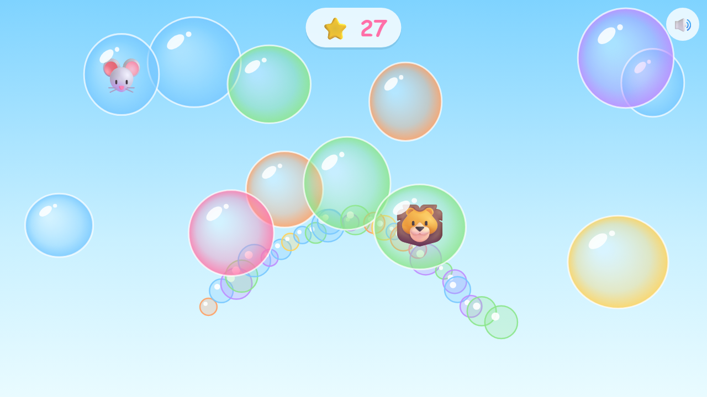

# Bubble Popper

A simple bubble popping game for little children. Colorful bubbles float around the screen. Tap one to pop it.

## Features

- **Pop bubbles:** tap or swipe a bubble to pop it. There's no timer, no losing and no game over.
- **Musical colors:** each color always plays the same note, so popping makes little tunes.
- **Animal friends:** some bubbles have an animal inside. Pop one to hear its sound (moo, woof, quack and more).
- **Bubble wand:** drag a finger to blow a trail of small bubbles that float up and pop.
- **Touch friendly:** big tap areas, multi-touch, and no long-press menus.

## How to play

Open `index.html` in any web browser. There's nothing to install. It works on computers, tablets and phones.

The 🔊 button in the corner turns the sound on and off.

## Screenshot

